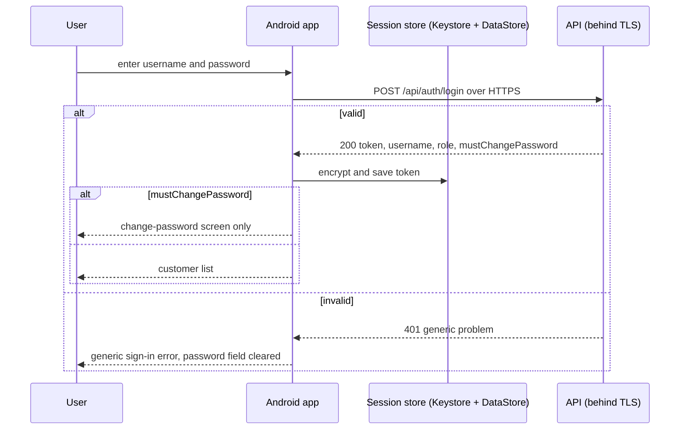
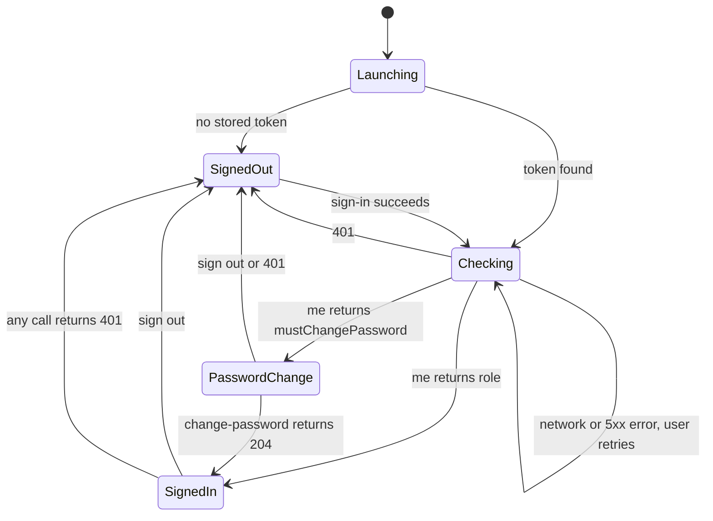

# Android app foundation, sign-in and session handling

## Context
This design delivers the whole `AAU` area: `AAU-0010` to `AAU-0110`. It creates the Android app under `apps/android` and builds the parts the other three designs reuse: the networking layer, the encrypted session store, navigation and the 401 handling. It adds sign-in, sign-out, the forced change of the initial password, the voluntary password change, and HTTPS-only transport, including the TLS exposure the phone needs. The API endpoints it calls come from the login PRD (`prd-login-permissions`, `tech-design-1`) and do not change here. `tech-design-2`, `tech-design-3` and `tech-design-4` build on this one, and this design owns what they share: the `ApiFailure` result type, the generic error component, the navigation guard and the per-screen window-security helper (see Proposed architecture, pieces 3 and 5).

## Out of scope
- Role-aware controls and 403 handling, because `tech-design-2` covers them.
- Customer screens, because `tech-design-3` covers them.
- The create-user screen, because `tech-design-4` covers it.
- Biometric unlock, single sign-on, password reset and session expiry, because the PRD excludes them.
- Store listing and signing keys for a public release, because the PRD excludes publishing.

## Proposed architecture
The app is a single activity that hosts a Compose navigation graph (ADR-1). A `SessionRepository` owns the token and the current user. An OkHttp interceptor adds the Bearer header, and an authenticator-style hook turns any 401 into a signed-out state that sends the user to the sign-in screen.

Launch and 401 handling follow one state machine. The app reads the stored token without a network call, then confirms the user with `GET /api/auth/me`.

Pieces, all under `apps/android` (package `com.customerservice.app`, names are proposals the first story confirms):

1. **Build.** Gradle with a version catalogue, one `app` module, `minSdk` 26 (Android 8.0) and the current stable `targetSdk`. The minimum is the architect's call: it covers current Keystore and `NetworkSecurityConfig` behaviour and answers the PRD's open question. Build types `debug` and `release` each set `API_BASE_URL` through `buildConfigField`.
2. **Transport (`AAU-0110`, ADR-3).** `ApiConfig` rejects a base URL that does not start with `https://` at start-up: the app shows a full-screen configuration error and makes no request, and it does not crash. The manifest sets `android:usesCleartextTraffic="false"`, and `res/xml/network_security_config.xml` trusts system authorities only. The `debug` configuration adds one development certificate authority that the local TLS front uses (see Affected repos).
3. **Networking.** Retrofit with kotlinx.serialization over OkHttp. `AuthInterceptor` adds `Authorization: Bearer <token>` to every request except `login`. `UnauthorizedInterceptor` clears the store and emits `SessionEvent.Expired` on any 401 from a call that carried a token (`AAU-0060`). `login` returning 401 does not trigger it; it shows the generic error instead (`AAU-0040`). The logging interceptor, if enabled in a debug build, logs method, path and status only: it never logs request or response bodies for any endpoint, and it redacts the `Authorization` header (`AAU-0070`). The other designs rely on that rule, so customer and user data never reach logcat.

    This design also owns the shared result type. `ApiResult` maps every response to an `ApiFailure` variant (`Unauthorized`, `Forbidden`, `Validation(fieldErrors)`, `NotFound`, `Conflict`, `Unavailable`) or a value. Field-error keys are normalised the way `apps/web/src/lib/api/http.ts` does it: case-insensitive, and for JSON-path keys such as `$.phoneNumber` the last segment is used. `ApiError` UI is one shared composable, `ErrorMessage`, that shows the fixed text "Something went wrong. Try again." for `Unavailable`. Whether it offers a **Retry** button is the caller's choice (`tech-design-3` and `tech-design-4` set the rule). `tech-design-2` adds only the 403 handling on top of this type.
4. **Session store (ADR-2).** `TokenCipher` wraps an AES-256 GCM key in the Android Keystore. `SessionStore` writes the ciphertext and IV to a Preferences DataStore file that backup rules exclude (`android:allowBackup="false"` plus `data_extraction_rules.xml` and `fullBackupContent` exclusions). It exposes the token as a `Flow` and an `awaitToken()` read for the interceptor. It keeps a copy in memory so a request never waits on disk.
5. **Navigation guard (`AAU-0030`).** A root `AppState` (`Launching`, `SignedOut`, `PasswordChange`, `SignedIn(role)`) drives the `NavHost`. Only the `SignedIn` branch contains customer or user routes, so no customer screen exists in the graph until sign-in. Deep links are not declared. `SecureWindow(enabled)` is a composable that sets `FLAG_SECURE` on the activity window when a screen enters and clears it when the screen leaves. The sign-in, change-password and create-user screens use it; customer screens do not.
6. **Sign-in (`AAU-0010`, `AAU-0040`).** `SignInScreen` and `SignInViewModel` post `{ username, password }`. The username is sent as typed; the API trims and lower-cases it. Any 401 or 400 shows one fixed message. A network or 5xx failure shows the shared `ErrorMessage` with a **Retry** button (piece 3). The password lives only in the field's state and is cleared after a failure.
7. **Sign-out (`AAU-0020`).** `POST /api/auth/logout`, then the store is cleared whatever the answer, so a failed call cannot leave the user signed in on the phone. The app returns to sign-in and the back stack is emptied.
8. **Session survival (`AAU-0050`).** The token is the only persisted state. Launch reads it without a network call, then calls `me`. A 401 ends the session; a network error keeps the token and offers retry, so a phone with no signal does not sign the user out.
9. **Forced and voluntary password change (`AAU-0080` to `AAU-0100`).** `ChangePasswordScreen` posts `{ currentPassword, newPassword }` to `POST /api/auth/change-password`. Field errors keyed `currentPassword` and `newPassword` (matched case-insensitively, as `ApiResult` does) show next to the fields and the typed values stay, as the web form does (`AAU-0080`). While `AppState` is `PasswordChange`, the graph contains only this screen and a sign-out action (`AAU-0090`). After a 204, the app calls `GET /api/auth/me` again and moves to `SignedIn(role)` with no new sign-in (`AAU-0100`). Signed-in users reach the same screen from an account menu.

## Affected repos & cross-repo contracts

### customer-service
Touched modules:

- New `apps/android` project (Gradle build, `app` module, manifest, network security configuration, backup rules, Kotlin sources, JVM tests and instrumented tests).
- `apps/api/helm/customer-service`: `values-staging.yaml` sets `ingress.enabled: true`, a host, a single path `/api` (so the anonymous `/health/live` and `/health/ready` stay unexposed) and `ingress.tls` naming a TLS secret. The template `templates/ingress.yaml` already renders `.Values.ingress.tls`, so only values change. The secret comes from the cluster operator (an existing secret or a cert-manager annotation); the chart does not create it. `values-prod.yaml` is not changed here: prod stays off until the architect accepts the exposure or a login-throttling change lands (see Risks). The chart's `version` is bumped, and the values comments, `templates/NOTES.txt` and the `helm` skill drop the claim that the API is never exposed.
- `docker-compose.yml`: an optional `tls-proxy` service (nginx, profile `mobile`) that terminates TLS in front of `api:8080`. A script, `apps/android/scripts/dev-tls.sh`, generates a local certificate authority and a server certificate for `localhost`, `10.0.2.2` (the emulator's name for the host) and the machine's LAN name into a gitignored `dev-certs/` directory. The private keys never leave that directory, and nothing secret is committed. The script also copies the public authority certificate to `apps/android/app/src/debug/res/raw/dev_ca.pem` (gitignored), which the debug network security configuration trusts. The debug build fails with a clear message when that file is missing. The API itself keeps listening on plain HTTP inside the Compose network.
- `.claude/pre-pr-checks`: an Android step (`./gradlew test lint`) when `apps/android` exists. It skips with a notice when no JDK or Android SDK is present, as the Helm step does when `helm` is missing, and `ci` documents that gap.
- `CLAUDE.md` (the line saying only the web app is public), the `dev-setup` skill and the `helm` skill: updated to describe the Android setup and the staging API ingress.

Seams:

- The app consumes `POST /api/auth/login` (`{ username, password }` returns `{ token, username, role, mustChangePassword }`), `POST /api/auth/logout` (204), `GET /api/auth/me` (`{ username, role, mustChangePassword }`) and `POST /api/auth/change-password` (`{ currentPassword, newPassword }`, 204 or 400 with `currentPassword` and `newPassword` field errors), exactly as `prd-login-permissions` `tech-design-1` defines them. The app has no contract of its own and no endpoint is added.
- Every other API call expects `Authorization: Bearer <token>`. A 401 means the session is gone; a 403 while a change is pending means the app has drifted from the API and shows the change-password screen.

## Security
- **Threat surface.** The API becomes reachable from phones, so `POST /api/auth/login` faces more callers than before. The API has no throttling or lockout (login PRD, Risks); this design adds none, and the exposure is recorded in Risks.
- **Authn/authz.** The Bearer token is the only credential. The app decides nothing about access beyond choosing screens, and the API enforces every rule.
- **Transport.** HTTPS only, enforced three ways: the start-up check on `API_BASE_URL`, `usesCleartextTraffic="false"`, and system-authority-only trust in release builds (ADR-3). No certificate pinning, because the PRD does not ask for it and a pin would tie every release to one certificate lifetime.
- **Secrets.** The token is encrypted with a non-exportable Keystore key and kept out of backups (ADR-2). The password is never stored. Neither appears in logs, crash reports, intents or `savedInstanceState`; the password field uses a `PasswordVisualTransformation` and `KeyboardType.Password`, and the screens set `FLAG_SECURE` so the sign-in and password screens are hidden from screenshots and the recents view.
- **Data classification.** The token and the username are confidential session data held only in app-private storage. Customer data is never written to disk by the app.
- **Build secrets.** Each developer generates their own local authority; only its public certificate is copied into the gitignored debug resources, so no key or certificate is committed. Release builds contain no development authority.
- **Ingress scope.** The staging ingress forwards only `/api`, so the health endpoints are not public.

## Performance & capacity
Assumptions: tens of staff, one sign-in per session. Targets on a mid-range phone over LTE: a launch to the customer list in under 2 s at p95, which includes the `me` call. The stored token is read without a network call, so a launch with no token shows the sign-in screen at once. A launch with a token shows a splash until `me` answers, because the role and the pending-password flag come only from the API. Decrypting the token takes one AES-GCM operation, well under 50 ms. Before rollout, measure cold start with a macrobenchmark on one emulator image and one physical device, and time the sign-in round trip through the TLS front against the plain API.

## Compliance & regulatory
N/A — the PRD names no regulation, and the app stores only a session token and a username on the phone. The design produces no audit evidence, because audit logging is outside both PRDs. It does make an API that serves customer personal data reachable from the internet in staging. Any data-protection review of that exposure belongs to the owner of the data, and the PRD leaves it out of scope.

## Observability & operations
N/A for metrics, because there is no analytics or crash-reporting service and the PRD asks for none. The app logs sign-in and sign-out events at `Info` level in debug builds only, without usernames, passwords or tokens, and release builds log nothing from the auth layer. A unit test asserts the redaction. Rollback is to install the previous build. The ingress and TLS change is reversible by redeploying the previous chart values.

## Data & storage changes
No server change, no migration. The app adds one local file: a Preferences DataStore holding the encrypted token and its IV, excluded from backup and device transfer. Clearing app data deletes it and signs the user out. A lost Keystore key (for example after a screen-lock reset on some devices) makes decryption fail; `SessionStore` treats that as no session. Excluding the file from backup answers the test plan's open question on backups: a restored backup never carries a session, and the product owner can reverse that choice.

## Decisions
- [ADR-1](../decisions/ADR-1.md): Kotlin, Jetpack Compose and a single-activity app in `apps/android`.
- [ADR-2](../decisions/ADR-2.md): Keystore-encrypted token in app-private DataStore.
- [ADR-3](../decisions/ADR-3.md): HTTPS only, with TLS in front of the API.

## Risks & rollout
- **Login endpoints are already on the default branch.** Sign-in, logout, `me` and change-password arrived with the merged login pull requests (#17, #18), so this design has no open dependency for them. The roles work (#19, #20) matters to `tech-design-2` and `tech-design-3`, not here.
- **Public exposure of the API.** Turning on the staging ingress makes the API reachable beyond the web app with no login throttling. Prod stays off in this design; enabling it needs the architect to accept that risk or a throttling change from its own PRD.
- **Certificate for local and test devices.** The emulator reaches the host as `10.0.2.2`, which the generated certificate names. A real device needs the generated authority installed, or a debug build that points at the staging host with a public certificate.
- **Tester distribution.** The PRD leaves it open. Debug and release APKs are built by Gradle and installed by `adb` or shared as files. A distribution service is a later choice.
- **Order.** API chart with TLS ingress first, then a build pointing at that host.

## Test strategy
- **JVM unit tests** (JUnit, MockK, Turbine, `MockWebServer`): `ApiConfig` rejects `http://`; `AuthInterceptor` adds the header and skips `login`; `UnauthorizedInterceptor` clears the store on a 401 and leaves it on a 403; `TokenCipher` round trip and failure on a wrong key; the logging interceptor redacts `Authorization`; `AppState` transitions from the state diagram, including a network error keeping the token.
- **Compose UI tests** with a fake API: no customer route is reachable in `SignedOut`; the password-change gate shows only change-password and sign-out; field errors and typed values stay after a 400; the generic sign-in error is identical for a wrong username and a wrong password.
- **Instrumented tests** on an emulator against a TLS-fronted Compose stack: sign in, restart the process and stay signed in, sign out, restart and stay out; a token read from the DataStore file is not plaintext; cleartext to `http://` fails; the 401 path after the session is deleted server-side. They cover the test plan's E2E and UI cases for `AAU-0010` to `AAU-0110`.
- **Manual** cases from the test plan for backups, screenshots and the recents view.

## Useful links
- [`prd.md`](../prd.md) and [`test-plan.md`](../test-plan.md) for this PRD.
- Login PRD: [`tech-design-1`](../../prd-login-permissions/designs/tech-design-1.md) for the endpoint contracts.
- Android documentation on the Keystore system, network security configuration and Auto Backup exclusions.
