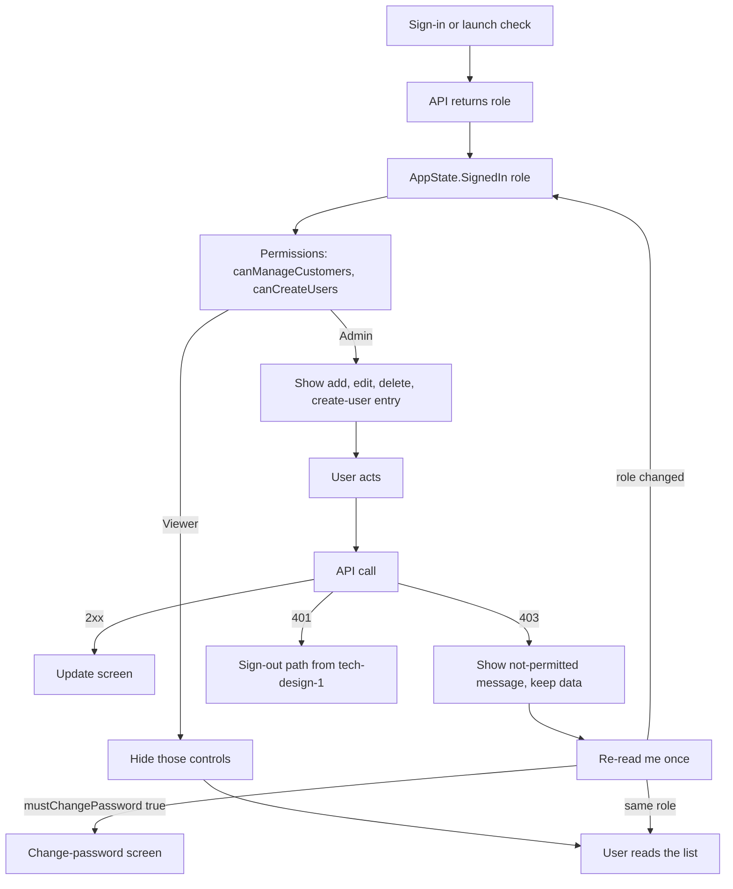

# Android role-aware screens and permission errors

## Context
This design delivers the whole `AAZ` area: `AAZ-0010` to `AAZ-0050`. It gives the app one source for the signed-in user's role, uses it to show or hide the Admin controls, and handles a 403 from the API without changing the data on screen. The role comes from the API (`GET /api/auth/me` and the sign-in response) and the API remains the only enforcement point (`AAZ-0050`). The role rules themselves come from the login PRD (`prd-login-permissions`, `tech-design-2`) and do not change. It builds on `tech-design-1` (session, `AppState` and the shared `ApiResult`/`ApiFailure` types) and supplies the role checks that `tech-design-3` uses. For `tech-design-4` it supplies only the `canCreateUsers` building block. Sign-in, `me` and the Viewer and Admin roles are on the default branch; the server-side role enforcement it relies on is in the login PRD's open pull requests #19 (customer endpoints) and #20 (web hiding), and `POST /api/users` is not built yet (login stories #12 and #15).

## Out of scope
- Any new role or permission, because the PRD excludes them.
- Customer list, forms and the create-user screen themselves, which `tech-design-3` and `tech-design-4` build. This design only defines how they learn what to show.
- Deciding permissions on the phone. The app hides controls as a courtesy, never as protection.

## Proposed architecture
`tech-design-1` already holds the role inside `AppState.SignedIn(role)`. This design adds a small `Permissions` value derived from it, a UI-state convention that every screen follows, and one shared 403 handler.

Pieces:

1. **Role and permissions (`AAZ-0050`).** `Role` is an enum (`Viewer`, `Admin`) parsed from the API's string. An unknown value maps to `Viewer`, the least privileged, so a future role never opens controls. `Permissions(role)` exposes `canManageCustomers` and `canCreateUsers`, both true only for `Admin`. `SessionRepository` stores the role in memory only and refreshes it from `me` on launch; nothing in the persisted store says what a user may do.
2. **Controls follow the permissions (`AAZ-0030`).** Screens read `Permissions` and do not compose the add button, the edit and delete actions on rows and the detail screen, or the create-user menu entry when it is false. The routes for the add, edit and create-user screens are registered only for an Admin, so a Viewer has no path to them in the navigation graph. This design owns that registration rule; `tech-design-3` and `tech-design-4` own the screens behind those routes.
3. **Everyone reads (`AAZ-0010`).** The list, search and detail routes (`tech-design-3` owns the detail screen) are available to both roles.
4. **Admin actions (`AAZ-0020`).** The add, edit and delete flows in `tech-design-3` are enabled when `canManageCustomers` is true.
5. **403 handling (`AAZ-0040`).** `tech-design-1`'s `ApiResult` already maps a 403 to `ApiFailure.Forbidden`; this design owns what happens next. Each view model shows a fixed message, "You don't have permission to do that", as a snackbar or a form-level message, and leaves the list, the form values and the page as they were. It does not refetch the list and does not sign the user out. The session logic then re-reads `me` once, whatever the cause of the 403. If the role changed, `AppState` updates and the controls follow. If `mustChangePassword` is true, the app routes to the change-password screen. If neither changed, nothing else happens.
6. **Role change while signed in.** The API gives a user's role only at sign-in and on `me`, and the PRD has no way to change a role. If an Admin is demoted on the server, the next Admin action returns 403 and the message shows. The new role takes effect at the `me` re-read that follows that 403 (piece 5), at the next launch or at the next sign-in.

## Affected repos & cross-repo contracts

### customer-service
Touched modules: the new `apps/android` project only (`Permissions`, `Role`, the 403 handling on top of `tech-design-1`'s `ApiResult`, and the navigation graph from `tech-design-1`). No API, web or deployment file changes.

Seams:

- Consumes `role` from `POST /api/auth/login` and `GET /api/auth/me` (`Viewer` or `Admin`).
- Relies on the API answering 403 to a Viewer on `POST`, `PUT` and `DELETE` `/api/customers` and on `POST /api/users`, with the data unchanged, as the login PRD's [`tech-design-2`](../../prd-login-permissions/designs/tech-design-2.md) defines. The customer part is in open pull request #19. The `POST /api/users` part does not exist until the login PRD builds it.
- Exposes no contract to other repos.

## Security
- **Threat surface.** None added. The only new surface is local UI state.
- **Authn/authz.** The API enforces access on every endpoint. The app's hidden controls are a usability aid; a modified client that shows them still gets 403 (`AAZ-0050`).
- **Default to least privilege.** An unknown or missing role gives `Viewer` permissions.
- **Secrets.** The role is not a secret and is not persisted.
- **Data classification.** No new data is stored or sent.

## Performance & capacity
N/A — the role is read from a value already in memory and adds no request. The launch `me` call is already made by `tech-design-1`. The only extra call is one `me` read after each 403, which is rare.

## Compliance & regulatory
N/A — the PRD names no regulation. The design produces no audit evidence, and audit logging is outside the PRD.

## Observability & operations
N/A — there is no metrics pipeline. A 403 is logged at `Info` in debug builds without request bodies. Rollback is to install the previous build.

## Data & storage changes
None. No server change, no migration, and nothing new on the phone.

## Decisions
- [ADR-1](../decisions/ADR-1.md): Kotlin and Compose, which the `Permissions` approach relies on.
- ADR-2 and ADR-3 apply through `tech-design-1`; this design makes no storage or transport choice of its own.

## Risks & rollout
- A stale role in memory can show a control the API will refuse. The 403 message covers it, and the `me` re-read after that 403 refreshes the role.
- Pull request #19 (customer endpoints Admin-only) must be on the default branch before the Admin and Viewer paths can be tested end to end. #20 is the web app's equivalent and does not block this design.
- Ships with `tech-design-1`, because it needs `AppState`.

## Test strategy
- **JVM unit tests:** `Role` parsing, with an unknown value giving Viewer permissions; `Permissions` for each role; on a 403 the data and form state stay unchanged and `me` is read once; a changed role updates `Permissions`.
- **Compose UI tests:** as a Viewer, no add, edit, delete or create-user control exists (the success metric requires 0 in every run), and the add, edit and create-user routes are absent from the graph; as an Admin, all are present; a fake API returning 403 on delete shows the message and the row stays.
- **Instrumented tests** against the TLS-fronted Compose stack from `tech-design-1`. The test setup seeds one Viewer and one Admin by inserting rows into the `Users` table (with a password hash the API accepts and `MustChangePassword` false, so the change-password gate does not block the tests), so the tests do not wait for `POST /api/users`. A seeded Viewer sees the list and no controls; a seeded Admin completes the add, edit and delete flows; a Viewer's request sent directly returns 403 and the customer count is unchanged. For a stale role, the test signs in as the Admin, demotes that row to Viewer in the database, then deletes a customer in the app: the message shows, the row stays, and the controls disappear after the `me` re-read. They cover the test plan's UI, API and E2E cases for `AAZ-0010` to `AAZ-0050`.

## Useful links
- [`prd.md`](../prd.md) and [`test-plan.md`](../test-plan.md).
- Login PRD: [`tech-design-2`](../../prd-login-permissions/designs/tech-design-2.md) for the role rules.
