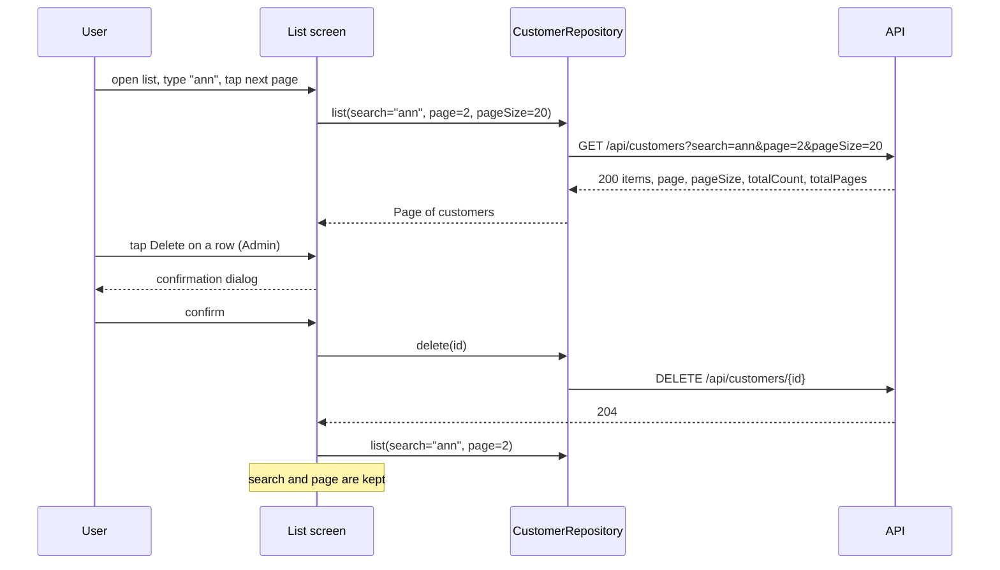

# Android customer list, search and forms

## Context
This design delivers the whole `ACU` area: `ACU-0010` to `ACU-0080`. It adds the customer screens to the Android app: a paged list with search, an add form, an edit form and a delete confirmation, with the API's field errors on the forms and a generic retry message when the API is unreachable. It calls the existing `/api/customers` endpoints and adds no endpoint. It builds on `tech-design-1` (networking, session, and the shared `ApiResult`/`ApiFailure` types and `ErrorMessage` component) and uses the `Permissions` value from `tech-design-2` to decide who sees add, edit and delete. The customer endpoints are on the default branch, but their Admin-only rule for writes is in the login PRD's open pull request #19, so Admin and Viewer behaviour cannot be verified end to end until it merges.

## Out of scope
- Offline use, local caching and background sync, because the PRD excludes them.
- Client-side validation rules. The API is the only source (repository convention), so the forms show its errors and apply no length or format checks of their own beyond the text field's `maxLength` hints from the contract.
- Sorting, filters other than search, and bulk actions, because the PRD asks for none.

## Proposed architecture
The list, detail and form screens share one `CustomerRepository` that wraps a Retrofit `CustomerApi`. View models expose `StateFlow` UI state.

Pieces:

1. **List (`ACU-0010`).** `CustomerListScreen` and `CustomerListViewModel` hold `search`, `page` and `pageSize` (20, the API default) in a saved state handle, so a configuration change or a return from a form keeps them. A `LazyColumn` shows each customer's name and email. Tapping a row opens the detail screen (piece 9). Previous and next controls and a "page n of m" label use the response's `totalPages`; they are disabled at the ends. Paging is explicit, as on the web, and not infinite scroll. The state handle holds only text and numbers, so no customer record survives in it. A request already in flight blocks a second one from the same control, and only the newest response updates the screen, so a quick double tap on **Next** moves one page.
2. **Search (`ACU-0020`).** A search field sends `search` after the user pauses typing for 400 ms or submits. Changing the search resets `page` to 1 and supersedes any request in flight, so only the newest response updates the screen. The API caps `search` at 100 characters, and the field stops at 100. A search with no matches shows an empty-state message.
3. **Add (`ACU-0030`).** `CustomerFormScreen` in create mode posts `{ firstName, lastName, email, phoneNumber, domain }` to `POST /api/customers`. A blank `phoneNumber` or `domain` is sent as `null`, because the API's phone check rejects `""`. The submit button is disabled while the request is in flight, so a double tap sends one request. On 201 it returns to the list, which reloads, so the new customer appears (`ACU-0030`). The typed values live in the form's view model, so they survive rotation and a failed request but not leaving the screen.
4. **Edit (`ACU-0040`).** The same screen in edit mode first loads `GET /api/customers/{id}`, so the fields start with current values, then sends `PUT /api/customers/{id}`. The list reloads on return.
5. **Delete (`ACU-0050`).** A confirmation dialog names the customer. On confirm the app calls `DELETE /api/customers/{id}` and reloads the list with the same `search` and `page`. If that page is now past the last page, the list moves to the last page. Cancel changes nothing.
6. **Field errors (`ACU-0060`, `ACU-0070`).** A 400 with a ProblemDetails `errors` map is matched to form fields on `firstName`, `lastName`, `email`, `phoneNumber` and `domain` using the normalisation in `tech-design-1` (case-insensitive, and the last segment of a `$.`-style key), and each message shows under its field. A 409 on create or edit shows on the email field. A 400 whose keys match no field, and every other non-409 failure, becomes a form-level message. The form keeps the typed values after every error. This matches the web app's rules in `apps/web/src/lib/api/http.ts` (`KNOWN_FIELDS`).
7. **Unreachable or server error (`ACU-0080`).** An `IOException`, a timeout or a 5xx becomes `ApiFailure.Unavailable`, and the screen shows `tech-design-1`'s `ErrorMessage`, never the server's text or a stack trace. Retry rules, per call:
    - List, detail and the edit form's initial load are reads: **Retry** repeats the same request.
    - Create and edit are writes whose answer may have been lost. After a failure the form shows **Retry** as a resubmit of the same values, with a note that the customer may already have been saved. A create that was in fact saved returns 409 on the email, which the form shows as a field error, and the user checks the list.
    - Delete shows **Retry** on the dialog. A repeated delete that finds the customer gone returns 404, which the app treats as done: it reloads the list.
    Retry keeps the form values, and a second tap while a request is in flight does nothing.
8. **Admin gating.** Add, edit and delete are composed only when `Permissions.canManageCustomers` is true; `tech-design-2` owns that rule and the route registration, and this design only reads it.
9. **Detail screen (`ACU-0010`).** `CustomerDetailScreen` loads `GET /api/customers/{id}` and shows every field, including the created and updated times in the phone's locale. Both roles can open it. Admins also see **Edit** and **Delete** here. A 404 shows the not-found message and returns to the list.

## Affected repos & cross-repo contracts

### customer-service
Touched modules: the `apps/android` project only (`CustomerApi`, `CustomerRepository`, the list, detail and form screens, and their view models; the shared error component comes from `tech-design-1`). No API, web or deployment change.

Seams, all defined by the existing API (`Contracts/CustomerContracts.cs`) and the login PRD's authorisation:

- `GET /api/customers?search=&page=&pageSize=` returns `{ items, page, pageSize, totalCount, totalPages }`. `page` is at least 1 and `pageSize` is 1 to 100.
- `GET /api/customers/{id}` returns a customer: `id`, `firstName`, `lastName`, `email`, `phoneNumber`, `domain`, `createdAtUtc`, `updatedAtUtc`.
- `POST /api/customers` and `PUT /api/customers/{id}` take `{ firstName, lastName, email, phoneNumber, domain }`. Limits are 1 to 100 characters for names, 256 for email, 32 for phone and 253 for domain.
- `DELETE /api/customers/{id}` returns 204.
- Errors: 400 with `errors` keyed by field, 401 (handled by `tech-design-1`), 403 (handled by `tech-design-2`), 404 (the customer is gone: the app shows a not-found message and returns to the list, except on a repeated delete, where it counts as done), 409 on a duplicate email.

## Security
- **Threat surface.** No new surface. Customer data is personal data on the phone's screen and in memory.
- **Authn/authz.** Every call carries the Bearer token; the API enforces roles (`tech-design-2`).
- **Secrets.** None added. The app never writes customer data to disk, logs or crash reports. `tech-design-1`'s logging rule (method, path and status only, no bodies for any endpoint) covers the `/api/customers` request and response bodies, and a unit test asserts it for them. Screens that show customer data allow screenshots, because the PRD does not forbid them; `FLAG_SECURE` applies only to the screens `tech-design-1` and `tech-design-4` name.
- **Data classification.** Names, emails and phone numbers are personal data held in memory only for as long as a screen shows them.

## Performance & capacity
Assumptions: up to a few thousand customers, 20 rows per page, tens of concurrent users. Targets on a mid-range phone over LTE: the list screen shows its first page within 2 s at p95 from tap, and a page change or search within 1.5 s at p95. Payload per page is about 20 small rows. Before rollout, time the list against a database of 10,000 customers through the TLS front and scroll the list on a low-end emulator image to check for dropped frames.

## Compliance & regulatory
N/A — the PRD names no regulation. The app is a client for data the API already holds, keeps none of it on the phone, and produces no audit evidence. If a regulation such as GDPR applies to the customer data, it already applies to the API and the web app and is outside this PRD.

## Observability & operations
N/A — there is no metrics pipeline. Failures are logged in debug builds with the status code and path, without bodies. Rollback is to install the previous build.

## Data & storage changes
None. No server change, no migration, and no local storage of customers. Search text and page live in a saved-state handle that Android may keep in the process but that holds no customer records.

## Decisions
- [ADR-1](../decisions/ADR-1.md): Kotlin and Compose for the screens and view models.
- ADR-2 and ADR-3 apply through `tech-design-1`; this design makes no storage or transport choice of its own.

## Risks & rollout
- The list, search and paging parameters are on the default branch. The Admin-only rule for writes is in open pull request #19, so the Viewer path of this design waits on it.
- A delete on the last row of the last page needs the page-clamp rule in piece 5, or the app shows an empty page.
- Two admins editing one customer: the API has no concurrency token, so the last save wins. The PRD does not ask for more.
- Ships after `tech-design-1`, together with `tech-design-2`.

## Test strategy
- **JVM unit tests** with `MockWebServer`: query parameters per page and search; a search change resets the page; a double tap sends one request; blank phone and domain are sent as `null`; the delete page clamp; the retry rule for each call (a repeated delete that gets 404 reloads the list); no customer body appears in the log output; error mapping for 400 (known and unknown keys), 404, 409, 5xx and `IOException`; the form keeps values after each error.
- **Compose UI tests** with a fake API: paging controls disabled at the ends; the form starts with current values; the delete dialog cancel does nothing; the confirm path keeps search and page; field errors show under the right field, including a case-insensitive key; the generic message never contains server text and Retry repeats the call.
- **Instrumented tests** on an emulator against the TLS-fronted Compose stack: add, edit, search and delete as an Admin; a duplicate email shows on the email field; stopping the API shows the generic message and Retry succeeds once it returns. They cover the test plan's E2E, UI and API cases for `ACU-0010` to `ACU-0080`.

## Useful links
- [`prd.md`](../prd.md) and [`test-plan.md`](../test-plan.md).
- `apps/api/src/CustomerService.Api/Contracts/CustomerContracts.cs` and `apps/web/src/lib/api/http.ts` for the contract and the matching field-error rules.
- [`tech-design-1`](tech-design-1.md) and [`tech-design-2`](tech-design-2.md) for the shared error handling and the role checks.
