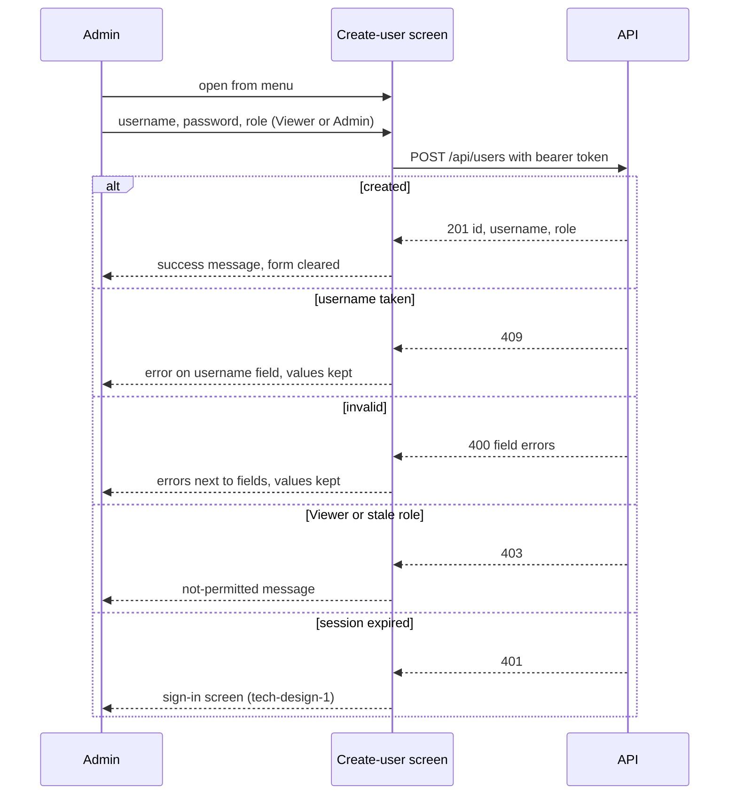

# Android Admin create-user screen

## Context
This design delivers the whole `AUS` area: `AUS-0010` to `AUS-0040`. It adds one screen to the Android app where an Admin creates a user from a username, a password and a role, over the existing `POST /api/users` endpoint. It adds no endpoint in this repository's API, and the endpoint does not exist yet: `POST /api/users` belongs to the login PRD's `tech-design-3` and its stories #12 and #15, which have no branch. This design cannot be verified end to end until that work lands. It builds on `tech-design-1` (networking, session and the shared error handling) and uses `Permissions.canCreateUsers` from `tech-design-2`. The account rules (initial password, forced change, username uniqueness) are the login PRD's and do not change.

## Out of scope
- Listing, editing, disabling and deleting users, and changing another user's password, because the PRD excludes them.
- Username and password rules in the app. The API decides, and the app shows its errors.
- Sending the new user their password. The Admin passes it on outside the app.

## Proposed architecture
A single screen with a view model, reached from an entry in the signed-in menu that exists only for Admins.

Pieces:

1. **Entry and route (`AUS-0010`, `AUS-0040`).** The menu entry and the `create-user` route are composed only when `Permissions.canCreateUsers` is true (`tech-design-2`), so a Viewer sees no entry and has no route.
2. **Form (`AUS-0010`).** `CreateUserScreen` has a username field, a password field with a show or hide toggle, and a two-option role selector (**Viewer**, **Admin**) that starts on Viewer, the least privilege. The password field uses `KeyboardType.Password`, and the screen wraps its content in `tech-design-1`'s `SecureWindow`, which sets `FLAG_SECURE` on entry and clears it on exit, so the customer screens stay capturable.
3. **Submit.** The view model sends `{ username, password, role }`. The button is disabled while a request is in flight, so a double tap sends one request. On 201 the app shows a confirmation naming the username and role, clears the fields (the password is never kept after success) and stays on the screen for the next user.
4. **Same account everywhere (`AUS-0020`).** The endpoint stores the user with an initial password that must change at first sign-in. The user can sign in to the app and the web app straight away with the chosen role, and the forced change from `tech-design-1` applies. The app does nothing beyond the call.
5. **Field errors (`AUS-0030`).** A 409 shows as an error on the username field and creates no second account. A 400's `errors` map is matched case-insensitively to `username`, `password` and `role`. Key matching follows `tech-design-1`'s normalisation. Unknown keys and other non-409 failures become a form-level message. A 403 and a 401 use the shared handling from `tech-design-2` and `tech-design-1`. A network or 5xx failure shows `tech-design-1`'s `ErrorMessage` with a note that the account may already exist. Typed values stay after each error, except that the password is cleared after a network failure that may have reached the server, so the Admin retypes it deliberately. After such a failure, a 409 on the retry means the first request probably succeeded, so the screen says the username already exists and suggests checking before choosing another.
6. **Cancelling.** Back leaves the screen and discards the fields.

## Affected repos & cross-repo contracts

### customer-service
Touched modules: the `apps/android` project only (`UserApi`, `CreateUserScreen`, `CreateUserViewModel`, the menu and the navigation entry). No API, web or deployment change.

Seams:

- `POST /api/users` (AdminOnly) takes `{ username, password, role }` with role `Viewer` or `Admin`, and returns 201 with `{ id, username, role }`, 400 with field errors, 401, 403 for a Viewer or a pending password change, or 409 for an existing username, as the login PRD's [`tech-design-3`](../../prd-login-permissions/designs/tech-design-3.md) defines it. That endpoint is unbuilt.
- The design assumes that endpoint trims and lower-cases the username before the uniqueness check, so `Alice ` and `alice` collide and the app does not repeat that rule. It also assumes the endpoint sets its own length limits; the form sets none, and any limit shows up as a field error. Both assumptions are checked against the endpoint when it lands.

## Security
- **Threat surface.** No new surface. The screen sends a new account's password, which is sensitive, over HTTPS only (`tech-design-1`).
- **Authn/authz.** The endpoint is AdminOnly. Hiding the entry is a usability aid, and the API answers 403 to anyone else.
- **Secrets.** The password lives only in the field state, is not written to disk, logs, intents or `savedInstanceState`, and is cleared after success. `FLAG_SECURE` hides it from screenshots and the recents view. A new user's initial password is a one-time secret the Admin chooses; the forced change in `tech-design-1` replaces it at first sign-in.
- **Data classification.** Usernames and initial passwords are confidential account data, held in memory only.

## Performance & capacity
N/A — one small request per user created, by a handful of Admins. The screen adds no polling or background work.

## Compliance & regulatory
N/A — the PRD names no regulation, and the app stores nothing about the new user. Audit logging of user creation is outside the PRD, so the design produces no audit evidence.

## Observability & operations
N/A — there is no metrics pipeline. Debug builds log the status code of the create call without the body. Rollback is to install the previous build; accounts already created stay.

## Data & storage changes
None on the phone. The server change, the `Users` table, comes from the login PRD and is unchanged.

## Decisions
- [ADR-1](../decisions/ADR-1.md): Kotlin and Compose for the screen and view model.
- ADR-2 and ADR-3 apply through `tech-design-1`; this design makes no storage or transport choice of its own.

## Risks & rollout
- `POST /api/users` is not built (login stories #12 and #15, no branch yet), so this design cannot be verified end to end, and its Story cannot start its instrumented tests, until that work merges.
- A create whose response is lost leaves the Admin unsure whether the account exists. The 409 wording above covers it, and the risk is accepted because the API offers no idempotency key.
- The Admin has to give the new user their initial password by some other route. That is a process gap the PRD leaves out and this design does not close.
- Ships last, after `tech-design-1` and `tech-design-2`.

## Test strategy
- **JVM unit tests** with `MockWebServer`: the request body for each role; 201 clears the fields; 409, 400 (known and unknown keys), 403 and network failure mapping; the password is cleared after success and after a network failure; one request for a double tap; a 409 after a network failure shows the check-first wording; a 401 routes to sign-in.
- **Compose UI tests:** the menu entry and the route are absent for a Viewer and present for an Admin (the success metric requires 0 create-user controls for a Viewer); the role selector starts on Viewer; the window has `FLAG_SECURE` on the create-user screen and not after leaving it; field errors show next to the right field with values kept.
- **Instrumented tests** on an emulator against the TLS-fronted Compose stack from `tech-design-1`: an Admin creates a Viewer, who then signs in to the app and, in a browser against the same stack, to the web app (the web leg is a manual check in the test plan, since the emulator suite does not drive a browser), is forced to change the password, and sees no Admin controls; creating the same username with different letter case and padding returns 409 and leaves one account. They cover the test plan's E2E, UI and API cases for `AUS-0010` to `AUS-0040`.

## Useful links
- [`prd.md`](../prd.md) and [`test-plan.md`](../test-plan.md).
- Login PRD: [`tech-design-3`](../../prd-login-permissions/designs/tech-design-3.md) for the endpoint contract.
