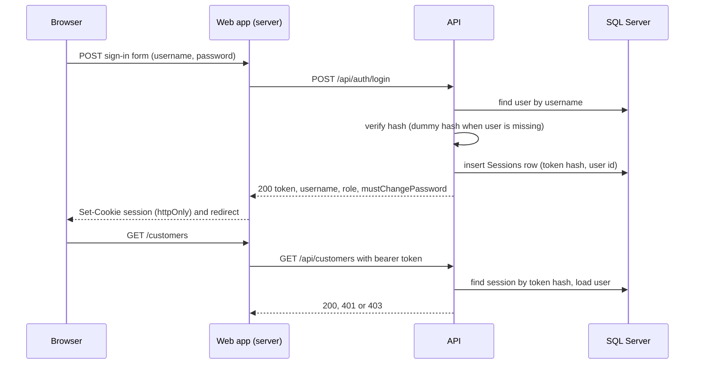
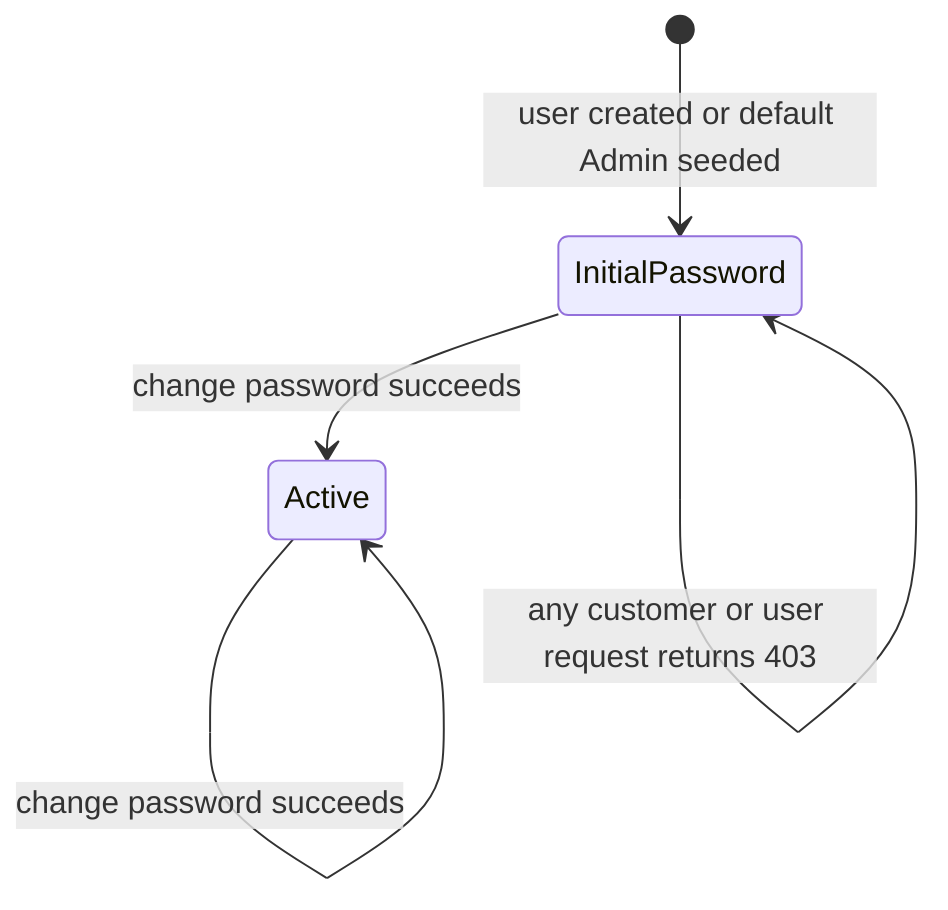

# Sign-in, sessions and forced password change

## Context
This design delivers the whole `AUTH` area: `AUTH-0010` to `AUTH-0120`. It adds users and sessions to the API, four auth endpoints, an authentication handler that protects every customer endpoint, and the web app's sign-in, sign-out, change-password pages and route protection. The API and the web app are both in the `customer-service` repository. The customer endpoints keep their current behaviour for a signed-in user, and `tech-design-2` adds role rules on top.

## Out of scope
- Roles on customer endpoints, the default Admin seed and role-aware screens, because `tech-design-2` covers them.
- Creating users, because `tech-design-3` covers it.
- Login throttling and account lockout, because the PRD does not ask for them (see Risks).
- Session expiry from inactivity and removal of old sessions, because the PRD forbids expiry.

## Proposed architecture
The API owns identity. The web app signs a user in by calling the API, then keeps the returned token in an httpOnly cookie and sends it on every API call (ADR-1, ADR-3).

Pending password change is a flag on the user. The state of a user's access follows it:

API pieces:

1. `User` entity (`Id`, `Username`, `PasswordHash`, `Role`, `MustChangePassword`, `CreatedAtUtc`) and `Session` entity (`TokenHash`, `UserId`, `CreatedAtUtc`), added to `CustomerDbContext`. `Role` is an enum (`Viewer`, `Admin`) in `Domain/Role.cs`, stored as a non-null string column of at most 20 characters, and `Username` is stored trimmed and lower-cased so the unique index is case-insensitive on every database. `tech-design-2` and `tech-design-3` use the type and the column and add no migration of their own.
2. `IAuthService` / `AuthManager` and `IUserRepository` / `UserRepository`, following the existing Controllers, `ICustomerService`, `ICustomerRepository` layering. `AuthManager` throws `UnauthorizedException`, a new exception that `GlobalExceptionHandler` maps to 401 with a generic message.
3. `AuthController` at `api/auth` with `POST login`, `POST logout`, `GET me` and `POST change-password`.
4. `SessionAuthenticationHandler`, which reads the bearer token, looks up its hash and builds a principal with the user id, role and a `must_change_password` claim. A `PasswordChangedRequirement` fails when that claim is present. It is added to the default policy and to every named policy, including `AdminOnly` from `tech-design-2`, because the fallback policy only applies to endpoints that carry no authorisation metadata of their own; an endpoint with `[Authorize(Policy = "AdminOnly")]` would otherwise let a pending Admin through. The fallback policy is the default policy, so unmarked endpoints are covered too. Customer and user endpoints therefore answer 401 with no session and 403 while the change is pending (`AUTH-0040`, `AUTH-0100`). Login and the `/health`, `/health/live` and `/health/ready` endpoints are marked anonymous. Logout, `me` and change-password use a `SignedIn` policy that omits the requirement so a pending user can reach them.
5. Login lower-cases and trims the submitted username, runs the hasher against a fixed dummy hash when the user is unknown, and returns the same 401 for a wrong username and a wrong password (`AUTH-0050`).
6. Change-password verifies the current password, rejects an empty or whitespace-only new password with a field error (`AUTH-0110`), stores the new hash and clears `MustChangePassword` (`AUTH-0080`). It also rejects a new password equal to the current one on every change, not only the first; this is stricter than the PRD asks, and it is the only way to stop a user keeping the initial password through the forced change. It leaves existing sessions alone, because `AUTH-0060` ends a session only at sign-out.

Web pieces:

1. `src/lib/api/auth.ts` (server-only) with `login`, `logout`, `getCurrentUser` and `changePassword`, and types in `types.ts`.
2. `apiFetch` in `src/lib/api/http.ts` reads the session cookie with `cookies()` and adds the `Authorization` header. A new `src/lib/auth/session.ts` holds the cookie name, `requireUser()` (cached per request, redirects to `/login` on 401 or no cookie, and to `/account/password` while a change is pending) and cookie helpers. Every page under `/customers` and `/users`, and the account page, calls `requireUser()` first; `proxy.ts` only checks that a cookie exists, so this call is what enforces `AUTH-0090`. The server actions rely on the API: a 401 from an action redirects to `/login`, and a 403 shows the generic form error from the existing `toFormState` mapping.
3. `src/proxy.ts` redirects any request without the session cookie to `/login` and leaves `/login`, `/api/health` and static assets alone. This check is optimistic; the API decides (ADR-3).
4. Pages `src/app/login/page.tsx` and `src/app/account/password/page.tsx` with server actions in `src/app/login/actions.ts` and `src/app/account/actions.ts`, following the `CustomerFormState` pattern. `layout.tsx` shows the signed-in username and a sign-out button.
5. The cookie is httpOnly, `SameSite=Lax`, and `Secure` when `SESSION_COOKIE_SECURE` is true, with a one-year `Max-Age`. That lifetime only lets the browser keep the cookie; the API never expires a session (`AUTH-0060`).

## Affected repos & cross-repo contracts

### customer-service
Touched modules:

- API: `Program.cs` (authentication, authorisation, DI for the new services), `Data/CustomerDbContext.cs`, new `Domain/User.cs` and `Domain/Session.cs`, `Errors/GlobalExceptionHandler.cs` and `Errors/Exceptions.cs`, new `Controllers/AuthController.cs`, `Contracts/`, `Services/` and `Data/` types, and a new migration under `Data/Migrations/`.
- Web: `src/lib/api/http.ts`, `src/lib/api/types.ts`, `src/app/layout.tsx`, new `src/proxy.ts`, `src/lib/auth/`, `src/app/login/`, `src/app/account/`.
- Deployment: `docker-compose.yml` and `apps/web/helm/customer-service-web` values and `templates/deployment.yaml` for `SESSION_COOKIE_SECURE`.

Seams:

- `POST /api/auth/login` takes `{ username, password }` and returns `{ token, username, role, mustChangePassword }`, or 401 with a generic problem body.
- `POST /api/auth/logout` returns 204 and deletes the session.
- `GET /api/auth/me` returns `{ username, role, mustChangePassword }`.
- `POST /api/auth/change-password` takes `{ currentPassword, newPassword }`, returns 204, or 400 with field errors keyed `currentPassword` and `newPassword`.
- Every other API endpoint except health expects `Authorization: Bearer <token>`.
- The web app adds `currentPassword`, `newPassword`, `username` and `password` to `KNOWN_FIELDS` in `http.ts`, per the repository convention.

## Security
- **Threat surface:** the new unauthenticated endpoint is `POST /api/auth/login`. The API stays reachable only from the web app. Cookie theft is limited by httpOnly and `SameSite=Lax`; server actions also get Next.js origin checks against cross-site posts.
- **Authn/authz:** bearer session token validated on each request; the fallback policy denies by default, so a new endpoint is protected unless it opts out (ADR-3).
- **Secrets:** passwords are hashed with `PasswordHasher` and never logged or returned (`AUTH-0070`, ADR-2). Only the SHA-256 of a session token is stored (ADR-1). No new secret is needed at deploy time.
- **Enumeration:** one generic 401 for any bad credential, plus a dummy hash verification so response time does not reveal whether the username exists (`AUTH-0050`).
- **Data classification:** usernames and password hashes are confidential account data stored in the existing database.

## Performance & capacity
Assumptions: up to 100 users and 50 requests per second on the customer endpoints. Each authenticated request adds one indexed read joining `Sessions` and `Users`; the target is under 10 ms added at p95 on the SQL Server container used for integration tests. Sign-in cost is dominated by the hasher; the target is under 500 ms at p95. Before rollout, run the integration suite against SQL Server and time a 100-request authenticated loop against an unauthenticated baseline.

## Compliance & regulatory
N/A — the PRD names no regulation, and the design stores only a username and a password hash. Audit logging is out of scope in the PRD, so this design produces no audit evidence.

## Observability & operations
N/A for metrics, because the service has no metrics pipeline. Sign-in failures and sign-outs are logged with message templates at `Information`, without the submitted username or password. Unexpected errors keep the existing `Error` path. `/health/live` and `/health/ready` stay anonymous so probes keep working. Rollback is to redeploy the previous image; the new tables stay and are ignored by the old version.

## Data & storage changes
Adds `Users` (unique index on `Username`) and `Sessions` (primary key on the token hash, index on `UserId`) in one migration, `AddUsersAndSessions`, generated with `dotnet ef migrations add`. `Customers` is unchanged. `dotnet ef migrations has-pending-model-changes` must report no changes before the PR. `CreatedAtUtc` columns follow the existing UTC conversion convention in `CustomerDbContext`.

## Decisions
- [ADR-1](../decisions/ADR-1.md): database-backed opaque sessions.
- [ADR-2](../decisions/ADR-2.md): `PasswordHasher` for password hashing.
- [ADR-3](../decisions/ADR-3.md): the API enforces access, the web app checks optimistically.

## Risks & rollout
- With no lockout or throttling, a caller who can reach the API can try passwords without limit. The API is internal to the web app, and the PRD does not ask for throttling. Raise it as a follow-up if the web app is exposed publicly.
- The migration and the code ship in one image. Before this change every customer request was open; after it, the web app and API must be deployed together, because an old web app sends no token and gets 401.
- Deploy order in Helm stays API first, then web.

## Test strategy
- Unit tests (xUnit, Moq strict): `AuthManager` for login success, wrong password, unknown user, change-password rules; handler for missing, malformed and unknown token; exception handler maps `UnauthorizedException` to 401.
- Repository tests on SQLite in memory for `UserRepository` and sessions.
- Integration tests (`CustomersApiTests` plus a new auth test class): 401 on every customer endpoint with no token; 403 while a change is pending, including on endpoints that carry the `AdminOnly` policy; an existing session survives a password change; mixed-case usernames sign in; sign-out invalidates the token; the customer suite signs in first through a helper added to `CustomerApiFactory`.
- Web tests (Jest and RTL): login and change-password actions map 401, 400 and 5xx to form state; `requireUser` redirects; `proxy` redirects when the cookie is absent. Keep the 80% coverage gate.

## Useful links
- Next.js 16 authentication guide, in `apps/web/node_modules/next/dist/docs/01-app/02-guides/authentication.md`.
- Next.js 16 proxy convention, in `apps/web/node_modules/next/dist/docs/01-app/01-getting-started/16-proxy.md`.
