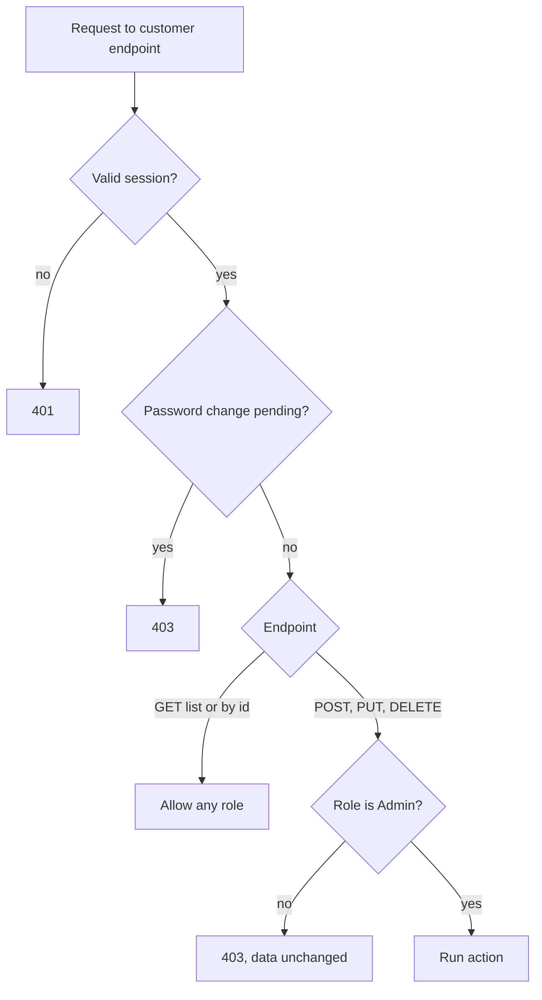

# Roles, default Admin and role-aware customer screens

## Context
This design delivers the whole `AUTHZ` area: `AUTHZ-0010` to `AUTHZ-0090`. It restricts customer add, edit and delete to Admins in the API, seeds the default Admin, and makes the web app hide and refuse those actions for Viewers. It builds on `tech-design-1`, which supplies the `User` entity with its `Role` column, sessions and the authentication handler. Reading customers keeps its current behaviour for any signed-in user.

## Out of scope
- Roles beyond Viewer and Admin and per-customer permissions, because the PRD excludes them.
- Creating other users, because `tech-design-3` covers it.
- Changing the default Admin's username, because the PRD sets none.

## Proposed architecture
Two roles are stored as a string-backed enum on the user. The authentication handler from `tech-design-1` puts the role in the principal as a role claim, so the API can authorise with standard policies (ADR-3).

API pieces:

1. The `Role` enum (`Viewer`, `Admin`) and its non-null string column come from `tech-design-1`. A user has exactly one role because the column is single-valued and not null (`AUTHZ-0010`).
2. An `AdminOnly` policy that requires the Admin role. `CustomersController` marks `Create`, `Update` and `Delete` with it; `List` and `GetById` rely on the fallback policy from `tech-design-1` (`AUTHZ-0020` to `AUTHZ-0050`, `AUTHZ-0090`).
3. `DefaultAdminSeeder`, called from `Program.cs` right after `MigrateDatabaseAsync` inside the same flag and `try` block. It inserts the `admin` user only when `Users` has no rows, with the hash of `Seed:DefaultAdminPassword`, the Admin role and `MustChangePassword` set (`AUTHZ-0070`, `AUTHZ-0080`, ADR-4).

Web pieces:

1. `requireUser({ role })` in `src/lib/auth/session.ts` (from `tech-design-1`) accepts a required role and redirects a Viewer to `/customers`. `src/app/customers/new/page.tsx` and `src/app/customers/[id]/edit/page.tsx` call it with `Admin` (`AUTHZ-0060`).
2. `src/app/customers/page.tsx` reads the current user and passes `canWrite` to the page header and to `CustomerTable`. A Viewer sees no **Add customer** link, no **Edit** link and no `DeleteCustomerButton`.
3. The server actions in `src/app/customers/actions.ts` stay as they are. A Viewer who bypasses the UI gets the API's 403, which `toFormState` shows as the generic save error and `deleteCustomerAction` shows as its existing "try again" message. That message is not accurate for a permission failure, and it is accepted because only a user who bypasses the UI sees it.

## Affected repos & cross-repo contracts

### customer-service
Touched modules:

- API: `Controllers/CustomersController.cs` (policy attributes), `Program.cs` (policy registration, seeder call), new `Data/DefaultAdminSeeder.cs` and `appsettings.json` (`Seed:DefaultAdminPassword`). The `Role` type and column ship in `tech-design-1`, so this design adds no migration.
- Web: `src/app/customers/page.tsx`, `src/app/customers/new/page.tsx`, `src/app/customers/[id]/edit/page.tsx`, `src/components/CustomerTable.tsx`, `src/lib/auth/session.ts`.
- Deployment: `docker-compose.yml` may set `Seed__DefaultAdminPassword`. The API Helm chart changes nothing and uses the `appsettings.json` default, because the chart's secret template only renders when `database.createSecret` is true and every environment uses `existingSecret`.

Seams:

- The API returns 403 with a ProblemDetails body when the role is insufficient. The web app treats 403 as a failed action and never as a reason to sign out.
- `GET /api/auth/me` returns the role string `Viewer` or `Admin`, which the web app compares exactly.

## Security
- **Authz:** the API is the only authority (ADR-3). Write endpoints require Admin; the fallback policy covers new endpoints by default. The web app's hiding is a convenience.
- **Default Admin:** the account has a known initial password by design (`AUTHZ-0070`), and the forced change from `tech-design-1` makes it unusable for customer work until the password is replaced. The window between first start and first sign-in is the exposure; keep a new deployment off the public network until the Admin has signed in.
- **Secrets:** the initial password is a documented, shared default and not a secret; the forced change at first sign-in is what protects the account. It is overridable in Compose through an environment variable. No Helm override is added, so no password goes into `values*.yaml`.
- **Data classification:** the role is internal account data.

## Performance & capacity
N/A — the role is read from the same session lookup as in `tech-design-1`, and the seeder runs once at start-up on an empty table, so neither adds a measurable cost.

## Compliance & regulatory
N/A — the PRD names no regulation, and audit logging is out of scope.

## Observability & operations
The seeder logs once at `Information` when it creates the Admin, and logs nothing when it finds users. A 403 returns through the existing status-code pages and is not logged as an error. Rollback is to redeploy the previous image; the Admin row stays and is ignored.

## Data & storage changes
No new table or migration. The `Users.Role` column comes from `tech-design-1`'s migration, and the single seeded row is written by this design's start-up seeder.

## Decisions
- [ADR-3](../decisions/ADR-3.md): the API enforces access, the web app checks optimistically.
- [ADR-4](../decisions/ADR-4.md): seed the default Admin at start-up when the user table is empty.

## Risks & rollout
- This design depends on `tech-design-1`; its tickets must land after the auth tickets.
- A deployment that applies migrations outside the API never seeds an Admin and nobody can sign in. Run the API once with `Database__ApplyMigrationsOnStartup` on, as Compose and the Helm chart already do.
- Existing customer data is untouched.

## Test strategy
- Unit tests: `DefaultAdminSeeder` creates the Admin on an empty store, does nothing when a user exists, and never resets an existing password. Controller tests assert the `AdminOnly` attribute on `Create`, `Update` and `Delete`.
- Integration tests: the fixture seeds an Admin and a Viewer directly through the repository with `MustChangePassword` false, because the start-up Admin begins with a change pending and would get 403 everywhere. For a Viewer, `GET` customer endpoints return 200 and `POST`, `PUT` and `DELETE` return 403 with the customer unchanged; for an Admin all return the success codes; the seeded Admin exists after start-up against an empty database and is not recreated on a second start.
- Web tests: a Viewer sees no add, edit or delete controls; direct visits to the add and edit pages redirect a Viewer to `/customers`; an Admin sees all three.

## Useful links
- Next.js 16 authentication guide, in `apps/web/node_modules/next/dist/docs/01-app/02-guides/authentication.md`.
