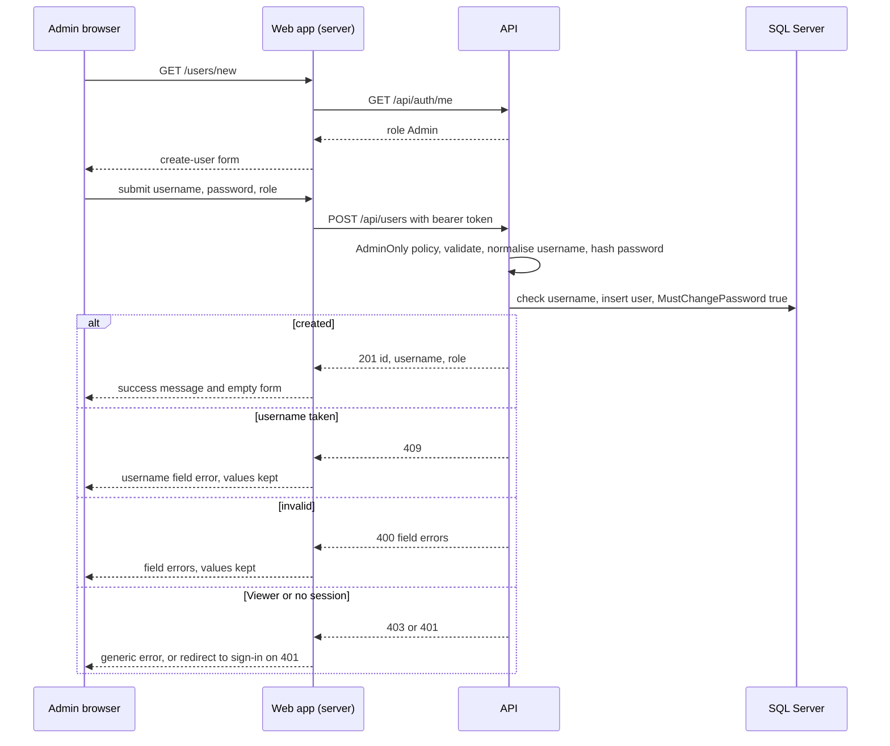

# Admin user-creation page and endpoint

## Context
This design delivers the whole `USR` area: `USR-0010` to `USR-0070`. An Admin gets a page in the web app and an API endpoint that create a user from a username, a password and a role. The new user starts on an initial password, so `tech-design-1` forces a change at first sign-in. It builds on `tech-design-1` (users, sessions, hashing) and `tech-design-2` (the `AdminOnly` policy and the `requireUser({ role })` helper).

## Out of scope
- Listing, editing, disabling and deleting users, because the PRD excludes them.
- Changing another user's password, because the PRD excludes it.
- Username and password rules beyond "not empty", because the PRD sets none.

## Proposed architecture
The page is a server-rendered form that posts to a server action, which calls a new API endpoint (ADR-3).

A Viewer who opens `GET /users/new` gets a 403 page, and a visitor with no session is redirected to sign-in (`USR-0050`).

API pieces:

1. `CreateUserRequest(string Username, string Password, Role Role)` in `Contracts/`, with validation attributes on the constructor parameters (never `[property: ...]`, per the repository convention). `Username` and `Password` use `[Required]`, whose default `AllowEmptyStrings=false` also rejects whitespace-only strings, so `[ApiController]` returns a 400 with field errors and no account is created (`USR-0070`). `Program.cs` registers `JsonStringEnumConverter` on the controllers' JSON options so `role` binds from `"Viewer"` or `"Admin"`; without it System.Text.Json rejects the string.
2. `IUserService` / `UserManager` that trims and lower-cases the username (the same rule `CustomerManager` applies to email), hashes the password with `PasswordHasher` (ADR-2), sets `MustChangePassword` to true and stores the user. Login lower-cases the submitted username the same way, so `Alice` and `alice` are one account on SQL Server and on the SQLite integration run alike. A duplicate username throws `ConflictException`, which the handler maps to 409 (`USR-0030`). If two requests race past the check, the repository catches the unique-index `DbUpdateException` and throws the same `ConflictException`, so the loser gets a 409 and not a 500.
3. `UsersController` at `api/users` with `POST` marked `AdminOnly`. Viewers get 403 and callers with no session get 401 from the policies in `tech-design-1` and `tech-design-2` (`USR-0050`). An Admin whose password is still the initial one gets 403 from the fallback policy in `tech-design-1`, which covers this endpoint too (`AUTH-0100`).
4. Users and roles live in the `Users` table from `tech-design-1`, so they survive a restart (`USR-0040`). A created user signs in at once with the chosen credentials (`USR-0020`).

Web pieces:

1. `src/app/users/new/page.tsx` renders a `UserForm` component with fields `username`, `password` and a role select (`USR-0010`). It reads the current user with `requireUser()`, which redirects an anonymous visitor to sign-in, and calls `forbidden()` from `next/navigation` for a Viewer so the page answers 403 as `USR-0050` asks. `forbidden()` needs `experimental.authInterrupts: true` in `next.config.ts` and an optional `src/app/forbidden.tsx`. This differs from the add and edit customer pages in `tech-design-2`, where the PRD asks only that a visit is refused.
2. `createUserAction` in `src/app/users/actions.ts` follows `createCustomerAction` except for its ending: on success it returns a success state and the form empties, rather than redirecting. It echoes the submitted `username` and `role` back, never the password, maps a 400 to field errors, a 409 to a `username` field error, and anything else to a generic form error.
3. `src/lib/form-state.ts` gains a `UserFormState` (`fieldErrors`, `formError`, `values` of `{ username, role }`, plus a `created` flag), because `CustomerFormState.values` is fixed to the customer fields.
4. `layout.tsx` shows a **Users** link to Admins only, read from the current user (`USR-0060`).
5. `createUser` in `src/lib/api/users.ts` (server-only). `tech-design-1` adds `username` and `password` to `KNOWN_FIELDS`; this design adds `role`.

## Affected repos & cross-repo contracts

### customer-service
Touched modules:

- API: new `Controllers/UsersController.cs`, `Contracts/UserContracts.cs`, `Services/IUserService.cs`, `Services/UserManager.cs`, and a method on `Data/IUserRepository.cs` and `UserRepository.cs`; `Program.cs` for DI registration.
- Web: new `src/app/users/new/page.tsx`, `src/app/users/actions.ts`, `src/components/UserForm.tsx`, `src/lib/api/users.ts`; changes in `src/lib/api/http.ts`, `src/lib/form-state.ts` and `src/app/layout.tsx`.

Seams:

- `POST /api/users` takes `{ username, password, role }`, where `role` is `Viewer` or `Admin`. It returns 201 with `{ id, username, role }`, 400 with field errors keyed `username`, `password` and `role`, 401, 403, or 409 when the username exists. The response never contains the password or its hash.

## Security
- **Threat surface:** one new authenticated endpoint, restricted to Admins by the `AdminOnly` policy. The web page re-checks the role, and the API decides.
- **Secrets:** the submitted password travels web app to API over the internal network and is hashed on arrival (ADR-2). It is never logged, echoed back or returned.
- **Privilege:** only an Admin can create an Admin, because the role comes from an Admin-only request.
- **Data classification:** usernames and hashes are confidential account data.

## Performance & capacity
N/A — user creation is a rare admin action. The only cost is one hash computation, covered by the sign-in budget in `tech-design-1`.

## Compliance & regulatory
N/A — the PRD names no regulation, and audit logging of who created whom is out of scope.

## Observability & operations
User creation logs at `Information` with a message template naming the new user's id and role, never the password. A 409 and 400 are expected outcomes and not logged as errors. Rollback is to redeploy the previous image; created users stay in the table.

## Data & storage changes
None. This design reuses the `Users` table and its unique `Username` index from `tech-design-1`. Usernames are stored lower-cased, so the index gives case-insensitive uniqueness whatever the collation, including SQLite, where the pre-PR gate runs the integration tests.

## Decisions
- [ADR-2](../decisions/ADR-2.md): `PasswordHasher` for password hashing.
- [ADR-3](../decisions/ADR-3.md): the API enforces access, the web app checks optimistically.

## Risks & rollout
- This design depends on `tech-design-1` and `tech-design-2`; its tickets land last.
- With no list or edit page and no password reset, a mistyped password at creation can't be corrected. The Admin creates a new user with a different username, which is a known PRD limit.

## Test strategy
- Unit tests: `UserManager` trims and lower-cases the username, hashes the password, sets `MustChangePassword`, and throws `ConflictException` on a duplicate; the repository maps a unique-index violation to `ConflictException`; the validation attributes sit on constructor parameters.
- Integration tests: an Admin creates a Viewer and an Admin, and each signs in and hits a forced-change redirect; a duplicate username, including one differing only in case, returns 409 and leaves one account; a Viewer gets 403, a missing token gets 401 and an Admin on an initial password gets 403; empty and whitespace-only usernames and passwords return 400; a `role` sent as a string binds; the user is still there after a second factory start.
- Web tests: `createUserAction` maps 400, 409 and 5xx to form state without echoing the password; the **Users** link shows for Admins and not Viewers; the page renders 403 for a Viewer and redirects an anonymous visitor to sign-in.

## Useful links
- Next.js 16 authentication guide, in `apps/web/node_modules/next/dist/docs/01-app/02-guides/authentication.md`.
